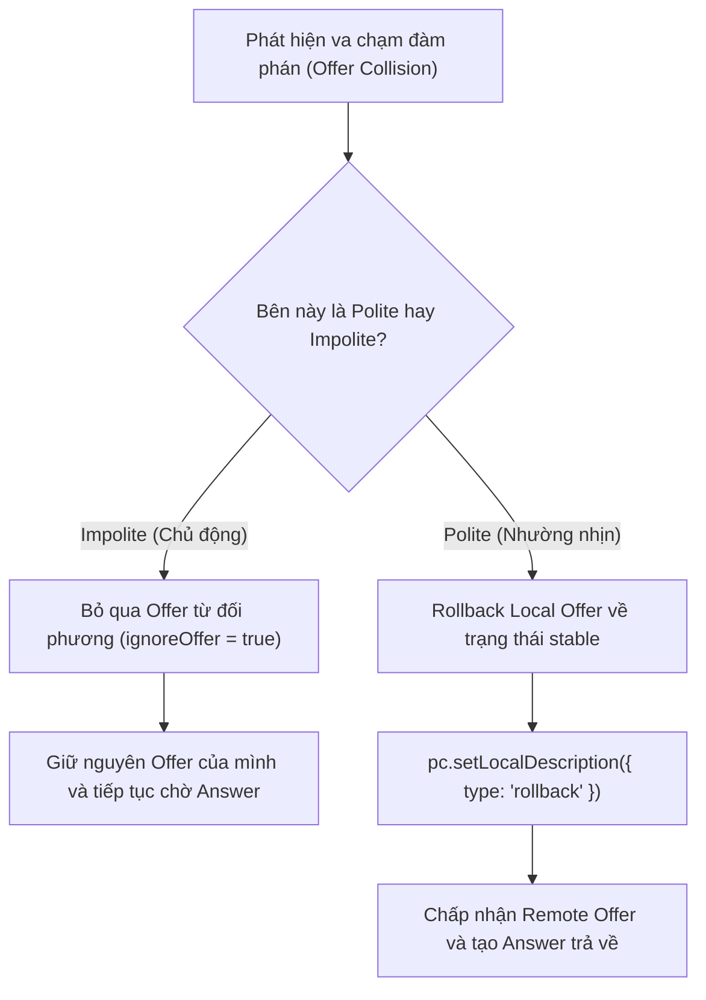

# Báo Cáo Kỹ Thuật: Các Thách Thức Cốt Lõi Trong Hệ Thống Video Call WebRTC Đa Luồng (Multi-Camera)

Tài liệu này tổng hợp và phân tích chuyên sâu các thách thức kỹ thuật ở tầng phần cứng, tầng giao thức mạng, và tầng ứng dụng khi triển khai hệ thống gọi video thời gian thực hỗ trợ đa luồng camera đồng thời.

---

## 1. Giới Hạn Băng Thông Bus Phần Cứng (USB Host Controller & Endpoint Bottlenecks)

### 1.1. Bản chất kỹ thuật
Phần lớn các bo mạch máy tính cá nhân và laptop sử dụng chung một vi điều khiển USB (USB Host Controller) để quản lý nhiều cổng cắm ngoài và camera tích hợp sẵn (thường thông qua chuẩn USB 2.0 hoặc USB 3.0).

```
                      [ CPU & RAM ]
                            │
               [ USB Host Controller ]
                (Băng thông tối đa: 480 Mbps)
               ┌────────────┴────────────┐
               │                         │
     [ Webcam Tích Hợp ]        [ Camera USB Cắm Ngoài ]
      (e.g., Sonix 720p)         (e.g., Arducam 12MP)
```

- Băng thông lý thuyết tối đa của USB 2.0 High-Speed là **480 Mbps**. Tuy nhiên, băng thông khả dụng thực tế cho việc truyền tải đẳng thời (Isochronous Transfers - chế độ truyền dữ liệu âm thanh/video thời gian thực có bảo đảm độ trễ) thường chỉ đạt khoảng **320 – 380 Mbps**.
- Khi một webcam hoạt động ở định dạng thô không nén (Uncompressed YUY2 / NV12) với độ phân giải $1280 \times 720$ ở $30 \text{ FPS}$:
  $$\text{Băng thông yêu cầu} = 1280 \times 720 \times 16 \text{ bit/pixel} \times 30 \text{ FPS} \approx 442 \text{ Mbps}$$
- Nếu máy tính đã có một camera đang chiếm dụng kênh Isochronous (ví dụ: Camera 12MP), việc mở thêm camera thứ hai sẽ vượt quá tổng dung lượng endpoint của Host Controller. Hệ điều hành Windows sẽ lập tức từ chối yêu cầu và trình duyệt ném ra lỗi `NotReadableError: Could not start video source`.

### 1.2. Giải pháp kỹ thuật đã triển khai
1. **Thuật toán Fallback Đa Tầng (Progressive Constraints Fallback):**
   - **Tầng 1 (720p):** Ưu tiên độ nét cao nếu phần cứng và bus cho phép.
   - **Tầng 2 (480p):** Tự động hạ xuống $640 \times 480$ khi Tầng 1 thất bại, giảm lượng dữ liệu trên bus xuống chỉ còn khoảng $\approx 147 \text{ Mbps}$.
   - **Tầng 3 (360p):** Hạ tiếp xuống $480 \times 360$ ($\approx 82 \text{ Mbps}$) để duy trì kết nối trong môi trường băng thông ngặt nghèo.
   - **Tầng 4 (Unconstrained Native):** Cho phép driver phần cứng tự thương lượng định dạng nén phần cứng (MJPEG / H.264) thay vì ép định dạng RGB/YUY2.
2. **Kiểm tra va chạm Device ID:**
   - Ngăn chặn việc trình duyệt tự ý trả về lại luồng của camera đã đang chạy khi gặp từ khóa `ideal`.

---

## 2. Xung Đột Trạng Thái Đàm Phán Tức Thời (Glare Collision & Perfect Negotiation)

### 2.1. Vấn đề "Glare Condition" trong đàm phán SDP
Trong các ứng dụng gọi video thông thường, quá trình đàm phán SDP (Session Description Protocol) chỉ diễn ra 1 lần duy nhất lúc bắt đầu. 

Tuy nhiên, trong hệ thống **Đa Camera Động (Dynamic Multi-Camera)**, người dùng có thể bật hoặc tắt camera bất kỳ lúc nào trong cuộc gọi:
- Giả sử tại cùng một thời điểm $t$, Peer A bấm bật Camera 2 và Peer B cũng bấm bật Camera 2.
- Cả hai bên đều tạo ra một SDP Offer mới và gửi đồng thời cho nhau qua kênh Signaling.
- Cả hai `RTCPeerConnection` đều đang ở trạng thái `signalingState = "have-local-offer"`.
- Khi Peer A nhận được Offer từ Peer B (và ngược lại), WebRTC engine sẽ ném lỗi `InvalidStateError` vì không thể xử lý Remote Offer khi đang chờ Answer cho Local Offer của chính mình. Kết nối đàm phán sẽ bị nghẽn (Glare) và đóng lại.

### 2.2. Giải pháp W3C Perfect Negotiation Pattern
Hệ thống giải quyết triệt để tình trạng Glare thông qua cơ chế phân quyền đối xứng:



- **Phân định vai trò:** Server gán cho người vào phòng trước là `isPolite = false` (Impolite Initiator), người vào sau là `isPolite = true` (Polite Callee).
- **Cơ chế Rollback:** Bên Polite khi phát hiện va chạm sẽ chủ động hủy bỏ Offer tạm thời của mình bằng `setLocalDescription({ type: 'rollback' })` để chấp nhận Offer từ bên Impolite, sau đó đàm phán lại luồng của mình ở chu kỳ tiếp theo mà không gây gián đoạn hình ảnh.

---

## 3. Phân Tách Đa Luồng Trên Một Kênh Truyền (Packet Demultiplexing)

### 3.1. Thách thức phân biệt nhiều video trên 1 cổng kết nối
Để vượt qua tường lửa NAT và tối ưu hiệu suất, toàn bộ các luồng âm thanh và hình ảnh của WebRTC được gom vào một cổng mạng UDP duy nhất bằng cơ chế `a=group:BUNDLE`.

Làm sao bên nhận có thể tách riêng gói tin nào thuộc về camera nào?

### 3.2. Cơ chế SSRC, MID và MediaStreamTrack ID
1. **Ở tầng vận chuyển (RTP Transport Layer):**
   - Mỗi luồng video được gắn một mã định danh nguồn ngẫu nhiên 32-bit gọi là **SSRC (Synchronization Source)**.
   - Mỗi khối `m=video` trong bản tin SDP mang một định danh **MID (Media ID)** (ví dụ: `mid:0`, `mid:1`).
   - Mọi gói tin RTP bay trên đường truyền đều chứa SSRC và MID trong header. Bộ giải mã mạng (Demuxer) của trình duyệt căn cứ vào đây để định tuyến gói tin vào đúng instance giải mã tương ứng.
2. **Ở tầng ứng dụng (Application Layer):**
   - WebRTC sinh ra mỗi luồng một `track.id` duy nhất.
   - Phía gửi truyền kèm một bản đồ **Metadata** qua WebSocket (`camerasMeta`) ánh xạ `track.id` $\leftrightarrow$ Tên hiển thị (ví dụ: `track-xxx` $\rightarrow$ "Webcam khuôn mặt", `track-yyy` $\rightarrow$ "Camera tài liệu").
   - Sự kiện `pc.ontrack` ở phía nhận kích hoạt độc lập cho từng track, tra cứu metadata và gắn vào khung hiển thị phù hợp.

---

## 4. Điều Khiển Tắc Nghẽn Mạng & Phân Phối Băng Thông (Congestion Control)

### 4.1. Thách thức về tải CPU và mạng Uplink
- Một luồng video 720p chuẩn WebRTC sử dụng codec H.264 hoặc VP8 cần khoảng $1.5 – 2.5 \text{ Mbps}$ băng thông Upload.
- Khi người dùng kích hoạt đồng thời 3 camera (Webcam chính, Camera góc 2, Chia sẻ màn hình), băng thông Upload tăng vọt lên **$5.0 – 7.5 \text{ Mbps}$**, đồng thời CPU phải gánh cùng lúc 3 tiến trình mã hóa khung hình thời gian thực.
- Nếu đường truyền của người dùng bị suy giảm tín hiệu (Packet loss, RTT tăng cao), cơ chế điều khiển tắc nghẽn (Google Congestion Control - GCC / TWCC) sẽ tự động bóp giảm bitrate.

### 4.2. Định hướng kỹ thuật xử lý
- **Phân bổ Bitrate theo tính chất camera:**
  - *Camera khuôn mặt (Facecam):* Ưu tiên tốc độ khung hình (30 FPS) để khẩu hình và cử động mượt mà.
  - *Camera tài liệu / Màn hình:* Có thể giảm tốc độ khung hình xuống 5 – 10 FPS thông qua `sender.setParameters()`, nhưng duy trì độ phân giải cao để chữ viết và sơ đồ không bị mờ.
- **Tận dụng Camera Ảo để kiểm thử tải:**
  - Cho phép đo kiểm độ ổn định của thuật toán điều khiển tắc nghẽn ngay cả khi phần cứng thử nghiệm bị giới hạn.

---

## 5. Đồng Bộ Hóa Trục Thời Gian & Lệch Pha Âm Thanh (Lip-Sync & Clock Drift)

### 5.1. Vấn đề trôi nhịp đồng hồ phần cứng (Hardware Oscillator Drift)
- Micro lấy mẫu âm thanh từ Card âm thanh (Clock nguồn 1).
- Camera 1 lấy mẫu hình ảnh từ chip cảm biến Webcam tích hợp (Clock nguồn 2).
- Camera 2 lấy mẫu từ vi xử lý ngoài của Camera USB (Clock nguồn 3).
- Các bộ dao động thạch anh trên các linh kiện phần cứng khác nhau luôn có độ sai lệch tần số nhất định (vài mili-giây sau mỗi chu kỳ hoạt động). Sau 30 – 60 phút đàm thoại liên tục, hiện tượng lệch nhịp giữa khẩu hình miệng và âm thanh (Lip-sync error) sẽ xuất hiện nếu không được đồng bộ.

### 5.2. Cơ chế xử lý
- WebRTC sử dụng các gói tin điều khiển **RTCP Sender Reports (SR)** định kỳ gửi kèm mốc thời gian tuyệt đối **NTP Timestamp (Network Time Protocol)** và **RTP Timestamp**. Phía nhận sử dụng các mốc này để tái đồng bộ (Resynchronization) các luồng đa phương tiện về cùng một trục thời gian tham chiếu thống nhất.

---

## 6. Khả Năng Mở Rộng Kiến Trúc (Scalability: Mesh P2P vs SFU)

### 6.1. Hạn chế của mô hình P2P Mesh trong bài toán đa camera
- Mô hình P2P (Peer-to-Peer) trong dự án hiện tại là tối ưu nhất cho bài toán 1-on-1: độ trễ thấp nhất, bảo mật đầu cuối, và không tốn chi phí hạ tầng máy chủ trung gian.
- Tuy nhiên, nếu mở rộng lên $N$ người tham gia, mỗi người có $K$ luồng camera:
  $$\text{Tổng số luồng video gửi/nhận} = N \times (N - 1) \times K$$
  Với $N = 4$ người, mỗi người bật $K = 2$ camera, toàn hệ thống phải chịu tải $4 \times 3 \times 2 = 24$ luồng video $\rightarrow$ Client sẽ cạn kiệt CPU và băng thông mạng.

### 6.2. Lộ trình nâng cấp mở rộng
- Cấu trúc thư mục của dự án đã được thiết kế sẵn với tầng `RoomManager` và `SignalingHandler` tách rời, cho phép trong tương lai chuyển đổi từ kiến trúc P2P sang kiến trúc **SFU (Selective Forwarding Unit như Mediasoup hoặc LiveKit)**:
  - Phía Client chỉ cần upload $K$ luồng lên SFU Server một lần duy nhất.
  - SFU Server sẽ đảm nhiệm việc phân phối chọn lọc các luồng video tới các client khác, đồng thời hỗ trợ **Simulcast** (phát song song nhiều độ phân giải cao/trung bình/thấp) để phù hợp với từng điều kiện mạng của người nhận.

---

## 7. Tổng Kết

| Thách Thức | Tầng Kỹ Thuật | Hậu Quả Nếu Không Xử Lý | Giải Pháp Đã Hiện Thực Hóa |
|---|---|---|---|
| **USB Bus Bandwidth** | Phần cứng / OS Driver | `NotReadableError`, camera thứ 2 không bật được | Fallback đa tầng (720p $\rightarrow$ 480p $\rightarrow$ 360p $\rightarrow$ Native) |
| **Glare Condition** | Báo hiệu / State Machine | `InvalidStateError`, đàm phán sập kết nối | Chuẩn hóa W3C Perfect Negotiation (Polite Rollback) |
| **Stream Demuxing** | Giao thức RTP / WebRTC | Không phân biệt được luồng video nào với camera nào | SSRC/MID demuxing + Bảng ánh xạ Metadata (`camerasMeta`) |
| **Network Congestion** | Băng thông / Mã hóa CPU | Mạng giật lag, rụng gói UDP, đơ trình duyệt | Đo kiểm realtime `pc.getStats()` & cách ly luồng |
| **Clock Drift** | Xử lý đa phương tiện | Hình một đằng, tiếng một nẻo sau thời gian dài | RTCP Sender Reports đồng bộ trục thời gian NTP |
